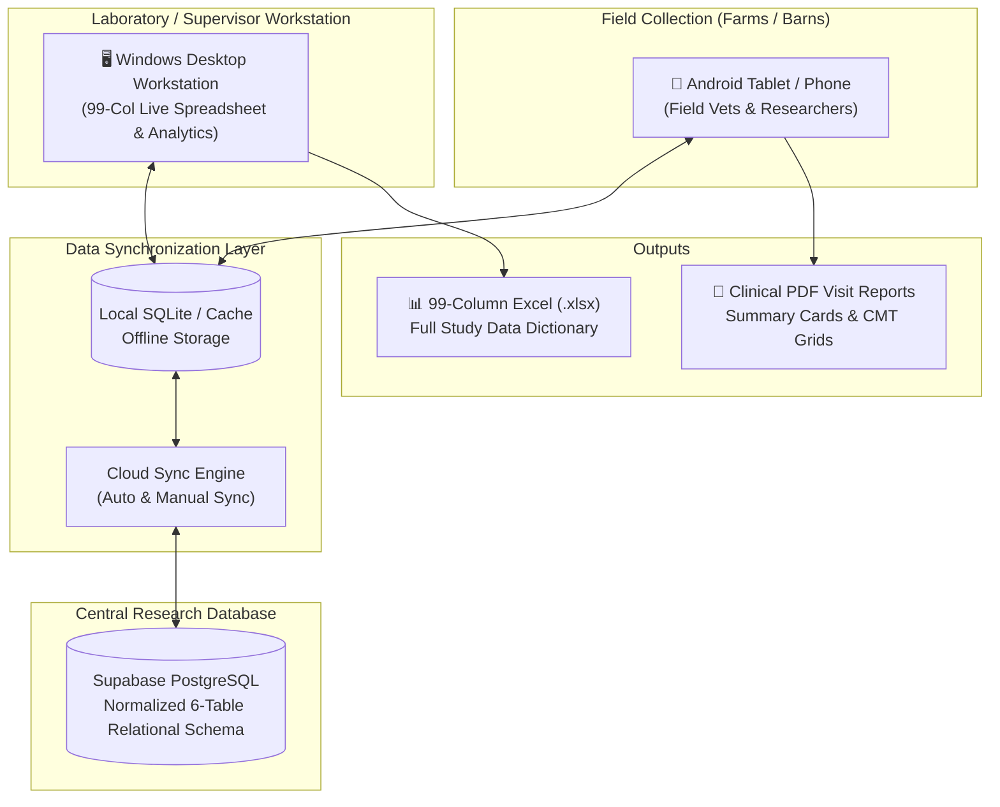

# 🐄 Mastitis Research & Udder Health Surveillance System

  
  <h3>Cross-Platform Digital Data Collection & 99-Column Epidemiological Surveillance Workstation</h3>
  
Standardized Longitudinal Udder Health, California Mastitis Test (CMT), Quarter-Level Diagnostics & Antimicrobial Stewardship for Nigerian Dairy Cattle Herds.

---

## 📥 Direct Downloads for Supervisors & Field Researchers

| Platform | Package | Description | Download Link |
| :--- | :--- | :--- | :--- |
| 🖥️ **Windows Desktop** | **Installer (`.exe`)** | Self-contained, single-click installer with desktop shortcut, 99-column interactive spreadsheet viewer, and offline SQLite cache. | [⬇ Download Desktop Setup (`.exe`)](https://github.com/Mufti-IBAK/mastitis_research/raw/main/releases/Mastitis_Research_Desktop_Setup.exe) |
| 📱 **Android Mobile** | **Release APK (`.apk`)** | High-contrast, large touch-target field application for barn-side data capture and offline-first syncing. | [⬇ Download Android APK (`.apk`)](https://github.com/Mufti-IBAK/mastitis_research/raw/main/releases/mastitis_research.apk) |

> **Flash Drive / Offline Installation:**  
> Both compiled release packages are also stored locally in the [`releases/`](releases/) directory of this repository for direct copying to USB flash drives.

---

## 🎯 Key Capabilities & Research Features

### 1. 📊 99-Column Longitudinal Surveillance Protocol
Strictly adheres to the comprehensive epidemiological data dictionary covering 99 standardized research parameters:
- **Columns 1–8 (Identifiers & Visit):** Record Key (Auto-derived `STATE-LGA-FARM-VISIT-COW-QTR-DATE`), State, LGA, Farm ID, Visit ID, Visit Date, Scheduled Date, Observer ID.
- **Columns 9–22 (Farm Baseline & Conditions):** Production system (Intensive, Semi-intensive, Extensive, Pastoral), Herd demographics, Milking method & frequency, Housing hygiene, Manure accumulation, Fly abundance, Water/feed security, Outbreak indicators.
- **Columns 23–37 (Cow Demographics & Reproductive History):** Local Tag ID, Breed/genetics, Age, Parity, Calving Date, Days in Milk (DIM auto-calculated), Pregnancy status, Previous mastitis history, Dry cow therapy, Teat sealants.
- **Columns 38–50 (Physiological & Clinical Metrics):** Test-day milk yield, Body Condition Score (BCS 1–5), Locomotion score, Udder hygiene score (1–4), Rectal temperature (°C), Antimicrobial administration (last 14d), Incomplete milking/suckling.
- **Columns 51–64 (Quarter Examination & CMT):** Quarter-level assessment (`LF`, `RF`, `LR`, `RR`), Functional status (Functional, Blind, Absent), Clinical Mastitis grading (Mild, Moderate, Severe), Teat-end hyperkeratosis score, Lesions, Rapid California Mastitis Test (Scores: `N`, `T`, `1`, `2`, `3`), Reagent batch tracking.
- **Columns 65–76 (Microbiology & Laboratory Diagnostics):** Lab sample ID, Quarter vs. Composite, Somatic Cell Count (SCC cells/mL), Somatic Cell Score (SCS auto-derived: $\log_2(\text{SCC}/100000)+3$), Culture identification, Primary pathogen isolate, Antimicrobial Susceptibility Testing (AST/AMR) profiles.
- **Columns 77–87 (Therapeutic Interventions):** Drug trade name, Active pharmaceutical ingredient, Exact dose & unit, Route (Intramammary, IM, IV, SC), Withdrawal periods, Treatment outcome tracking.
- **Columns 88–96 (Husbandry & Milking Routine Hygiene):** Water sources, Forestripping, Pre-milking teat sanitization, Towel drying method, Glove compliance, Post-milking disinfectant teat dip.
- **Columns 97–99 (Documentation & Compliance):** Missing sample justification, Protocol deviations, Field qualitative notes.

---

### 2. 🖥️ Desktop Workstation: 99-Column Interactive Spreadsheet
Designed specifically for supervisors, principal investigators, and epidemiologists:
- **Pinned Key Columns:** Frozen lead headers (`Record Key`, `Farm ID`, `Cow ID`, `Quarter`) remain permanently visible during horizontal scrolling across all 99 data attributes.
- **Live Search & Dynamic Filtering:** Instant filtering by State, Farm, Cow ID, Positive CMT status (`N`, `T`, `1`, `2`, `3`), Clinical Mastitis cases, Pending Lab results, or Antimicrobial treatments.
- **One-Click Native Excel Export (`.xlsx`):** Generates fully formatted, publication-ready research workbooks matching the official laboratory template with auto-calculated statistical summaries.
- **Synchronized Top & Bottom Scrolling:** Smooth dual-controller synchronization prevents layout drift across massive data sets.

---

### 3. 📱 Mobile Field App: Built for Rough Dairy Barns
- **Large Touch Targets (≥ 48–56dp):** Built for rapid thumb entry while wearing veterinary gloves in high-glare farm environments.
- **Color-Coded CMT Scoring:** Instant high-contrast buttons (`N` green, `T` yellow, `1` light amber, `2` orange, `3` crimson red).
- **Offline-First Dual Storage:** Full data entry capabilities without internet connection. Automatically queues records locally in SQLite / shared preferences and syncs bidirectionally to Supabase PostgreSQL when connectivity is restored.
- **Unified Multi-Observer Tagging:** Every record is stamped with the respective field investigator's Observer ID to prevent attribution conflicts.

---

## 🛠️ Quick Installation Guide

### Windows 10 / 11 Installation
1. Download [`Mastitis_Research_Desktop_Setup.exe`](https://github.com/Mufti-IBAK/mastitis_research/raw/main/releases/Mastitis_Research_Desktop_Setup.exe).
2. Double-click the installer.
3. Follow the setup wizard (creates desktop shortcut and Start Menu entry).
4. Launch **Mastitis Research Desktop** from your Desktop or Start Menu.

### Android Installation
1. Download [`mastitis_research.apk`](https://github.com/Mufti-IBAK/mastitis_research/raw/main/releases/mastitis_research.apk) on your Android device.
2. Open the downloaded file. When prompted, tap **Settings** and allow **Install Unknown Apps** for your browser/file manager.
3. Tap **Install** and open the app.
4. Sign in with your researcher credentials to start collecting or reviewing herd data.

---

## 🏛️ System Architecture

---

## 👥 Research Team & Collaboration
This research system is developed for the **Longitudinal Bovine Udder Health & Mastitis Surveillance Project in Northern Nigeria**.

- **Repository:** [https://github.com/Mufti-IBAK/mastitis_research.git](https://github.com/Mufti-IBAK/mastitis_research.git)
- **Principal Contact:** Mufti-IBAK / Mastitis Research Team
- **Support & Issues:** Submit inquiries or observations via GitHub Issues.